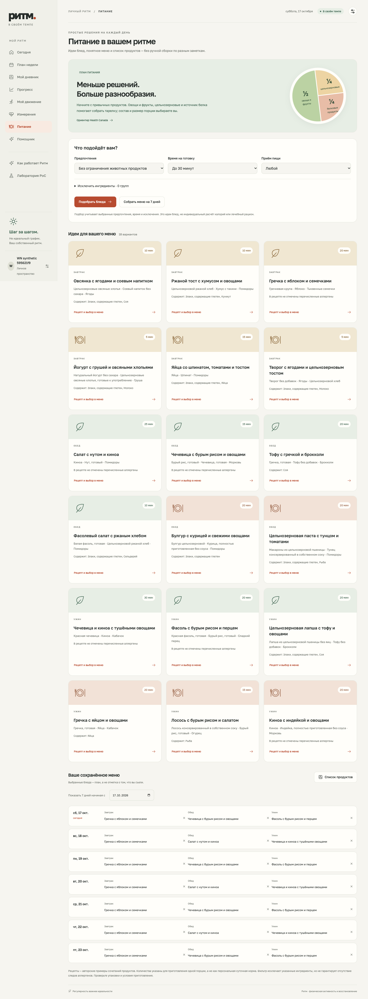
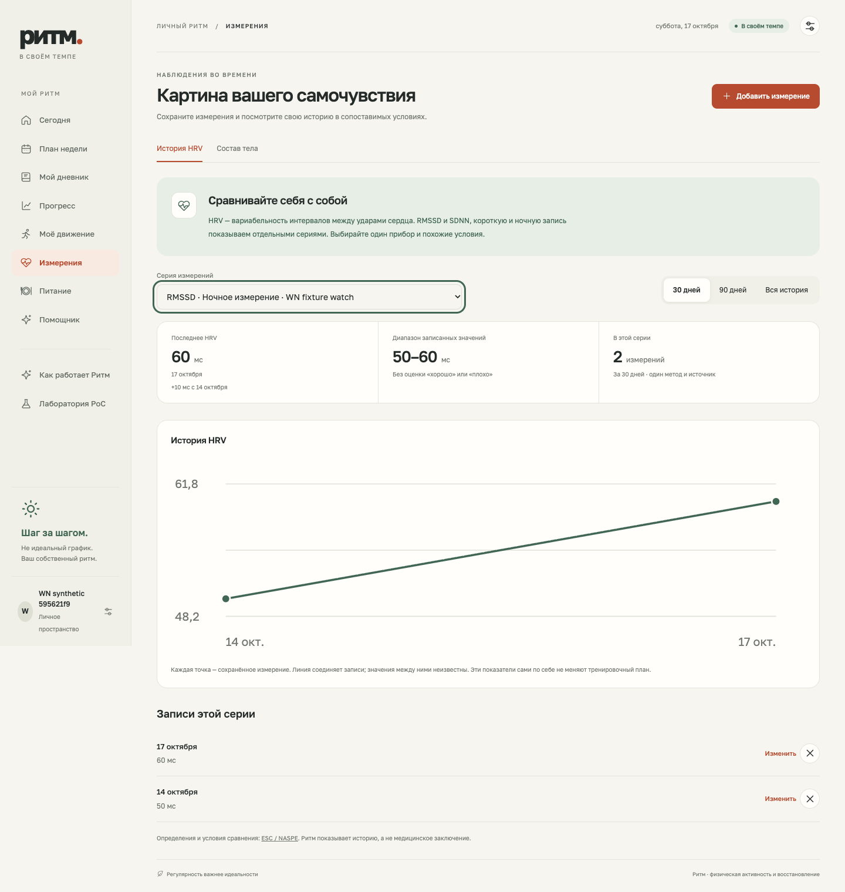

# Ритм: AI, занятия, измерения и питание

> Последующее подключение DeepSeek описано в [отдельном отчёте](deepseek.md). Ниже сохранены результаты предыдущего этапа.

17 октября 2026. [Открыть Ритм](http://127.0.0.1:8080/), [помощника](http://127.0.0.1:8080/#assistant), [измерения](http://127.0.0.1:8080/#wellness), [питание](http://127.0.0.1:8080/#nutrition). Код и интерфейс работают локально. Серверный OpenAI-ключ в этой среде отсутствует; живой ответ провайдера не выдаётся за выполненную проверку.

Следующий завершённый этап: [аккаунты сайта, восстановление и управление сеансами](accounts-release.md). Числа ниже относятся к AI-этапу; повторные проверки новой версии сохранены отдельно в `evidence/accounts/`.

## Что изменилось для пользователя

- **Вопрос по своим данным:** подготовленный сервером контекст вместо ручного копирования дневника в чат; ответ показывает исходные факты.
- **Разбор 14 дней:** наблюдения, пробелы в истории и следующий небольшой шаг. Неизвестные значения не превращаются в нули, импорт не складывается с зачтённой тренировкой как второй факт.
- **Запись фразой:** текст превращается в проверяемый черновик. Человек исправляет поля и отдельно сохраняет; потерянный ответ и конфликт версии имеют путь восстановления без нового платного запроса.
- **Занятие под обстоятельства:** время, дома/на улице/в зале, без прыжков. Предпросмотр ничего не сохраняет; выбранный вариант попадает в план, историю, календарь и контекст помощника. Исходное расписание остаётся неизменным.
- **Метрики бега:** импортированные минуты, известная дистанция и темп. Пропуски данных явно обозначаются, расчёт не использует плановые минуты.
- **HRV и состав тела:** добавление, подтверждённое исправление и удаление измерений, графики за 30/90 дней и всю историю. RMSSD/SDNN, окна, приборы и методы разделены на сопоставимые серии. Вес и доля жира могут быть известны независимо.
- **Питание:** 18 рецептов с ингредиентами и шагами, предпочтения, время готовки и исключение групп аллергенов. Предпросмотр семи дней сохраняется одним подтверждением; доступны замены, удаление, история меню и список покупок для скачивания.
- **Единая история:** новые сведения входят в экспорт/восстановление. В AI-контексте видны только ограниченные подтверждённые факты; названия приборов, которые могут содержать имя, заменены номерами серий. Выбранное меню явно отличается от съеденного.

Дизайн сохраняет визуальный язык Ритма. Для взаимодействий использованы публичные паттерны [Freeletics](https://www.freeletics.com/en/blog/posts/getting-started-with-freeletics/) — подстройка занятия — и [WHOOP](https://www.whoop.com/us/en/thelocker/new-ai-guidance-from-whoop/) — объяснение данных в контексте. Ритм связывает запись, объяснение и подтверждаемое действие в одном цикле: пользователь видит основания ответа и управляет изменением своего плана. Превосходство в удобстве ещё требуется проверить сравнительным UX-тестом; оно не объявляется доказанным наличием функций.

## Покрытие презентации без подмены статусов

| Слайды / история | Состояние этой сборки |
|---|---|
| 20–21, US01–06 | Цель/опыт/время, неделя, сегодня, факты, сон/усталость, объяснимая адаптация и принятие недели — реализованы |
| 4/22, ограничения и виды занятий | Реализованы время, место и ограничение прыжков через проверяемые варианты; диагнозы и реабилитационные назначения не подбираются |
| 21, US07 напоминания | Настройки, ICS/VALARM и уведомление открытого браузера; фоновая доставка Telegram ещё не реализована |
| 21, US08 графики | Реальные отметки сна/усталости и выполнения за 7/30 дней, детали дня; отдельные графики измерений |
| 21, US09 часы | Файловый CSV/TCX импорт, дубликаты и привязка к расписанию; прямого OAuth/API-подключения производителя и FIT нет |
| 21, US10 LLM-вопрос по истории | Адаптер Responses, согласие, контекст и интерфейс реализованы и проверены fixtures; для живого запуска нужен ключ |
| 22, метрики бега | Аналитика импортированных пробежек; неизвестная дистанция не даёт выдуманного темпа |
| 4/22, питание | Реализованы каталог, фильтры, меню, замены, сохранение и список покупок; лечебный рацион, добавки и индивидуальные нормы не рассчитываются |
| 4/22, HRV, состав тела | Реализован ручной учёт измерений с методами, сериями, историей и переносом; автоматического API часов/весов нет |
| 17/30, отказ LLM | Deadline3с, локальный рабочий путь, circuit3ошибки→60с→5успешных запросов, квоты; проверено искусственными отказами |
| 17/30, согласие и защита сведений | Отдельное согласие, HMAC контекста с5мин сроком, отсутствие имени/TelegramID, изоляция, no-store Responses; provider retention описан честно |

## Проверка

Полные результаты и точные команды находятся в [checks.json](evidence/ai-product/checks.json); SHA-256 исходников — в [source-manifest.json](evidence/ai-product/source-manifest.json).

- [Go unit/integration/race](evidence/ai-product/go-test.txt): все пакеты PASS; `go vet`, `staticcheck`, `gofmt` и build также PASS. Statement coverage: `aicoach` 95.4%, `openai` 89.6%, HTTP 87.9%, domain 91.0%, nutrition 98.1%. CLI wiring не объявляется покрытым unit-тестами.
- [RAT](evidence/ai-product/rat.json): 16/16, критические 5/5, 5000 вычислений без ошибок; p95 0.006042 мс. Измеряет локальные правила, не LLM latency и не медицинский результат.
- [HTTP smoke](evidence/ai-product/http-load.json): 300/300 успешных операций за 30 секунд при 10 запросах/с, ошибок 0; p95 запроса 13.25 мс, p95 с задержкой генератора 15.29 мс. Это loopback одного Go/JSON-процесса, не оценка публичной нагрузки.
- [AI и варианты в браузере](evidence/ai-product/browser.json): 10 проверок — варианты/apply/revert, согласие, отдельное исправление/сохранение черновика, основания ответа, деградация, 320–1440 px. AI-ответы здесь **синтетические fixtures**, маркировка сохранена на скриншотах.
- [Измерения и питание в браузере](evidence/ai-product/wellness/browser.json): 10 групп сценариев; реальные операции сохранения, исправления, удаления, конфликта вкладок, меню, скачивания списка и export/restore. Восемь сочетаний страниц/ширины 320/390/768/1440 px без горизонтального переполнения. Обе синтетические сессии очищены.
- [JavaScript](evidence/ai-product/frontend-tests.txt): 51/51 — ревизии, смена аккаунта/даты, позднее открытие окна, ручное восстановление после конфликта, подтверждение замены, применение текущих фильтров, серии измерений и расчёт метрик.
- Базовые сценарии повторены отдельно: [основной цикл — 20 проверок](evidence/ai-product/regression/browser.json), [полный цикл — 13](evidence/ai-product/regression/full-product-browser.json). Итого 53 браузерные проверки/группы, ошибок JavaScript нет.

Независимый review внешних вызовов, согласия, вариантов, измерений и питания не оставил открытых P1/P2 в просмотренном коде. Проверены приватность названий приборов, ограничение контекста на максимальном архиве и недействительность согласия после каждой операции с измерениями/меню. Найденные пограничные случаи исправлены и получили regression tests. Последний Go-прогон включает проверку, что малые положительные величины не превращаются в нули. Это ограниченная инженерная проверка, не утверждение об отсутствии любых дефектов.

## Запуск и эксплуатационные границы

Задайте `OPENAI_API_KEY` только на сервере, при необходимости `OPENAI_MODEL` и `AI_HOURLY_LIMIT`, затем перезапустите процесс. [README](../README.md) и [.env.example](../.env.example) описывают настройки. Ключ не вводится в интерфейс и не нужен в переписке. Интеграция построена по [официальной схеме Responses](https://developers.openai.com/api/docs/guides/structured-outputs?api-mode=responses); [`store:false`](https://developers.openai.com/api/docs/guides/your-data) не обещает отсутствия всех журналов провайдера.

Внешний вызов:3с, без повторов;4 параллельных,6/аккаунт/10мин,60/процесс/час по умолчанию. Реальные стоимость/качество/доступность модели проверяются отдельным smoke с искусственными данными после настройки. Лимиты и circuit относятся к одному процессу; файловое хранилище также рассчитано на один процесс.

Для запуска в Telegram остаются публичный HTTPS-адрес и бот владельца; живой Telegram-тест не проведён. Сравнительный UX-тест, пилот и экспертный разбор правил из [пакета защиты](defense.md) остаются открытыми продуктовыми проверками. Предоставленная шкала RAT-PoC не требует завершить весь пилот для защиты: для максимума нужно предъявить работающий образец, результат RAT, обоснованный обход риска и матрицу трассируемости. [Аудит презентации](presentation-readiness-audit.md) отделяет эти критерии от готовности публичного продукта. Результаты исследований и итоговый балл не заявляются заранее. Git-коммиты не создавались.
