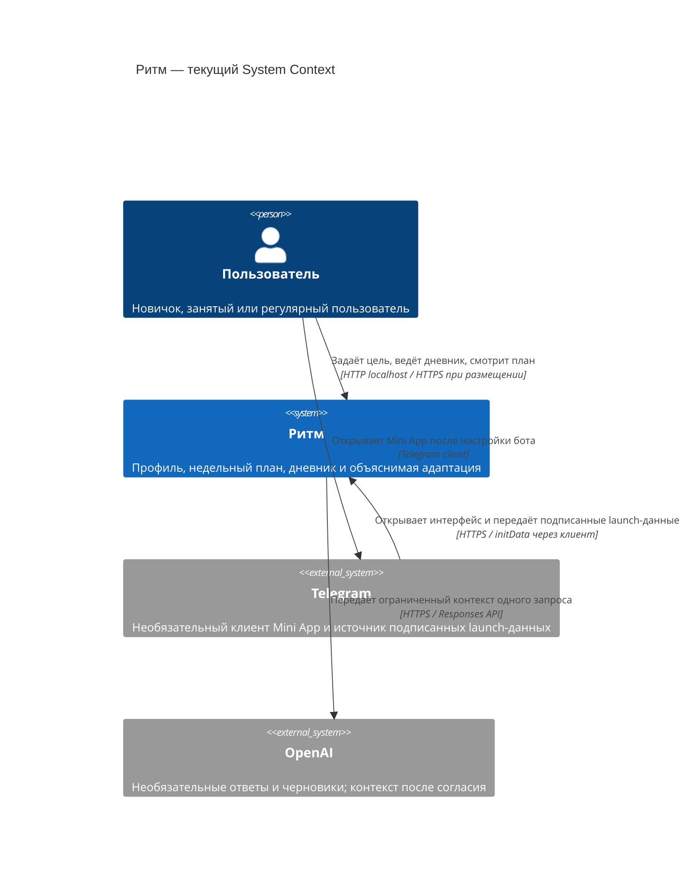
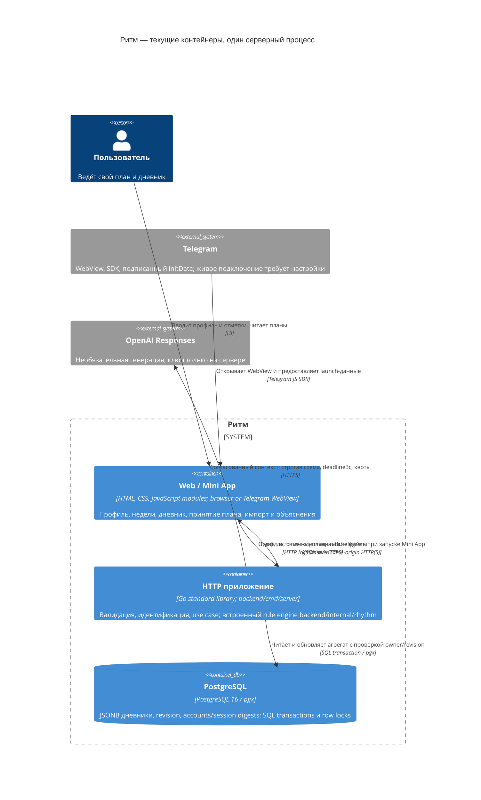
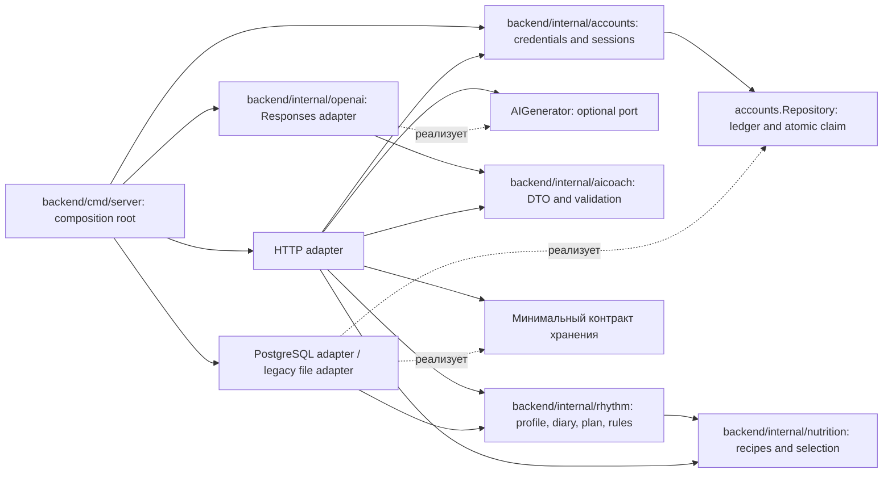
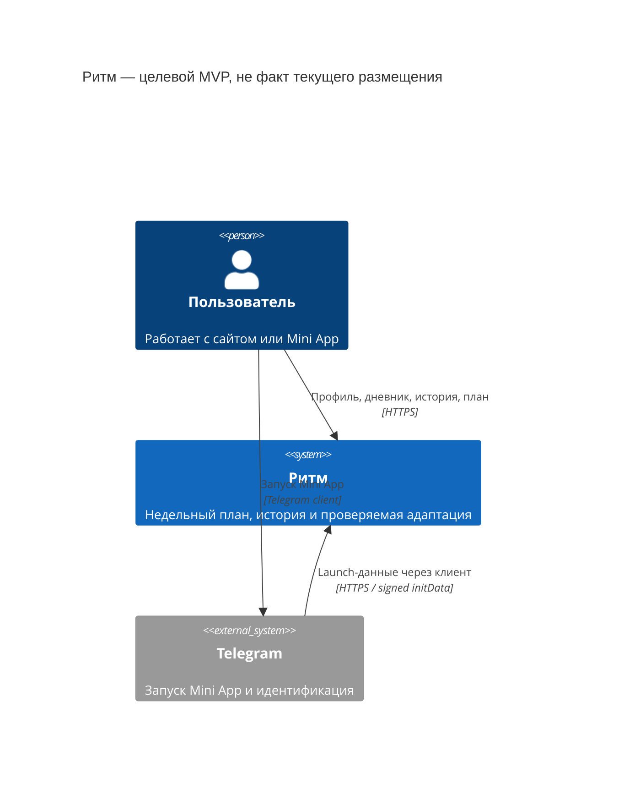
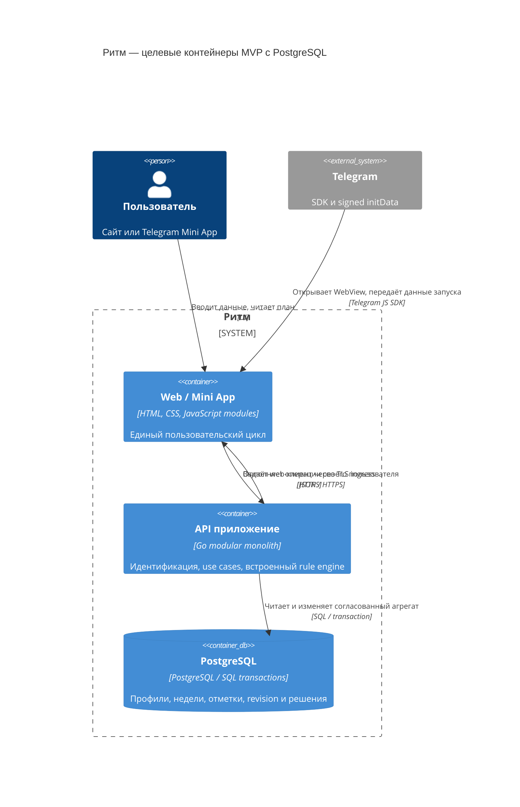

# «Ритм»: архитектура текущего PoC и развитие

Дата: 17.10.2026. Решения закреплены в [ADR-01](adr/001-go-modular-monolith.md), [ADR-02](adr/002-deterministic-adaptation.md), [ADR-03](adr/003-storage-poc-and-postgresql.md) и [ADR-04](adr/004-telegram-client-and-identity.md). Факт выполнения тестов подтверждается [пакетом защиты](defense.md), а не наличием диаграммы.

## Текущий контур

Текущая сборка — один Go-процесс, который отдаёт статический web-клиент и HTTP API. Правила планирования и адаптации находятся в `backend/internal/rhythm`, постоянные аккаунты и сессии — в `backend/internal/accounts`. Текущее хранилище — PostgreSQL: JSONB-агрегаты дневников и отдельные таблицы аккаунтов/сессий; транзакции и row locks. [ADR-08](adr/008-postgresql-storage.md) описывает схему и переключение; прежний file adapter остаётся только для немигрированного однопроцессного PoC. JavaScript и CSS встраиваются в бинарник; отдельный Node-сервер для запуска сайта не нужен. [Решение об аккаунтах и атомарном присоединении гостя](adr/007-persistent-website-accounts.md).

Telegram Mini App — второй способ открыть тот же web-клиент. Серверная проверка подписи проверяется локальными fixtures; реальная работа Telegram требует bot token, HTTPS-адреса и настройки запуска. Причины и ответы ассистента формируются по правилам с указанием исходных фактов. Необязательный OpenAI Responses adapter обслуживает вопросы, обзор 14 дней и черновики после отдельного согласия; основной расчёт не вызывает модель. Реализованы ручной импорт CSV/TCX, экспорт календаря ICS и сохраняемые настройки напоминания; прямого подключения к аккаунтам часов и серверной рассылки Telegram нет.

Ниже используются типы C4: Person — человек; Software System — система целиком; Container — отдельно исполняемое приложение или хранилище. Rule engine — модуль Go-приложения, не отдельный контейнер. PostgreSQL — отдельный DB-server в текущей Container-диаграмме.

### C4 L1 — System Context текущей сборки



Telegram — внешняя система, но не обязательная зависимость браузерного сценария. Стрелка не означает вызов Telegram API при каждой записи: подпись initData проверяется локально на сервере. Импорт тренировок получает выбранный пользователем файл; он не обращается к API производителя часов. OpenAI — необязательная внешняя система, подключаемая серверным ключом; платежей в продукте нет.

### C4 L2 — Container текущей сборки



Web-клиент исполняется в браузере, поэтому это отдельный C4-container даже при отдаче файлов тем же бинарником. PostgreSQL блокирует строки между процессами. Ограничение «один процесс на DATA_DIR» относится только к прежнему файловому режиму.

## Направление зависимостей и владельцы



Это схема зависимостей исходного кода, не дополнительный уровень C4. Core владеет инвариантами профиля, расписания, дневника, переноса истории и приоритетом правил. HTTP-граница разбирает JSON, проверяет доступ и переводит ошибки в стабильный ответ. Минимальный `Repository` принадлежит потребителю `backend/internal/httpapi`; `backend/internal/postgresstore` и `backend/internal/filestore` реализуют его неявно. Хранилище владеет отменяемой блокировкой, чтением/записью и сохранением целого агрегата; оно не определяет спортивные правила. Парсеры файлов, формирование ICS и ответы ассистента находятся в отдельных узких пакетах; transport преобразует их модели на границе. Входные slices и указатели глубоко копируются при передаче владения.

В `backend/cmd/server` зависимости передаются явно. Context приходит из HTTP-запроса первым параметром операций ввода-вывода. Нет брокера, фоновой очереди или скрытого DI-registry. Необязательный LLM adapter получает context с deadline3с; lifecycle принадлежит запросу. Квоты/circuit защищены mutex и не создают фоновых goroutine. Для shutdown есть владелец — исполняемый сервер. Нельзя оставлять goroutine после завершения их владельца.

Сервис аккаунтов владеет своим минимальным Repository. Он не зависит от модели дневника: атомарная регистрация передаёт только гостевой principal и проверенную revision. Файловый адаптер под общим lock закрепляет нового владельца `u_<id>` за прежним `g_<id>.json` одной записью ledger; проверка владельца применяется и к запросам, допущенным до регистрации. Пароли вычисляются вне lock, а сравнение актуальных credentials выполняется внутри update. Подробнее о KDF, recovery, отзывах, отмене I/O и лимитах — [ADR-07](adr/007-persistent-website-accounts.md).

AI согласие, минимизация контекста, квоты и варианты занятий описаны в [ADR-05](adr/005-optional-ai-and-session-variants.md). Внешний API вызывается вне файловой транзакции; ответ не может менять нагрузку или сохранять запись без пользователя.

HRV, состав тела и выбранное меню входят в тот же агрегат и атомарные операции. Независимый `backend/internal/nutrition` содержит каталог, фильтры и подбор; домен использует его для проверки канонических ID рецептов. UI сравнивает только одинаковые серии измерений. Новые сведения не меняют пороги нагрузки. Ограниченная AI-проекция заменяет пользовательские названия приборов номерами серий. Подробности совместимости backup v2, полной замены измерений, batch меню и границ интерпретации — [ADR-06](adr/006-measurements-and-nutrition.md).

## Контракт адаптации

Уточнение 22.10.2026: будущий профиль остаётся базой предложения, а режим восстановления дополнительно ограничен известным текущим расписанием с заменами; неизвестные минуты не считаются нулями. Формула и граничные случаи зафиксированы в [ADR-02](adr/002-deterministic-adaptation.md). Это устраняет увеличение минут восстановления после сокращения текущей недели или увеличения будущего профиля.

Расписания недель сохраняются как неизменяемые снимки. План текущей недели накладывает статусы дневника и явно выбранные SessionAdjustments на её снимок; изменение профиля не переписывает назначенные типы, дни или длительности текущей и прошлых недель. Настройки профиля задают базу будущих предложений. Запись факта не меняет длительность профиля, повторный расчёт не накапливает процент увеличения.

`nextPlan` — отдельное вычисляемое предложение на следующую неделю. Пользователь принимает его явно с revision, датой недели и token показанного предложения. `acceptedNextPlan` — сохранённое принятие; новые отметки или изменения профиля не подменяют его. До начала недели принятие можно отменить, затем принять актуальное предложение. В понедельник принятое расписание становится текущим; при отсутствии принятия создаётся базовое расписание. Принятый прогресс +5% не становится новой базой следующих вычислений автоматически.

Календарный переход материализуется атомарно внутри repository transaction. Обычный GET не меняет revision; смена недели или миграция меняет её один раз. Отдельного фонового процесса для создания недель нет. Все границы дат используют настроенный серверный часовой пояс, по умолчанию Europe/Moscow. История допускает добавление и исправление фактов за последние 90 дней по реально сохранённому расписанию; более старые записи можно просматривать, экспортировать и явно удалять.

Для прежних агрегатов без снимков миграция сохраняет реальные факты и помечает неизвестные детали занятия как `detailsKnown:false`, `minutes:0`. Даже совпадение даты с нынешним профилем не доказывает прежний тип или длительность. Эти минуты не входят в сумму и не выдаются за измеренную нагрузку. Неотмеченные занятия текущей недели получают базовое расписание; несуществующая история выполнений не создаётся.

| Приоритет | Условие по актуальным данным недели | Решение |
|---|---|---|
| 1 | Усталость ≥8/10 **или** сон <6 ч | Восстановление: на одно занятие меньше, минимум одно; минуты ×0.8 с округлением вниз, минимум 15 |
| 2 | Минимум два разных запланированных занятия пропущены | Упрощение: на одно занятие меньше, минимум одно |
| 3 | Все уникальные запланированные занятия выполнены, сон ≥7 ч, усталость ≤4/10 | Мягкий прогресс: предложение +5% минут, верхняя граница 90 мин |
| 4 | Недостаточно истории или критерии выше не выполнены | Исходный/сохранённый объём и явная причина отсутствия прогресса |

Это демонстрационные пороги из PoC. Экспертная и пользовательская проверка остаются открытыми. Под «доступной длительностью» анкеты понимается длительность базового занятия. Предложение +5% может её превышать, поэтому показывается отдельно и не применяется автоматически. Если продукт потребует жёсткий недельный бюджет, это будет отдельное правило и новый тест.

Входные числа валидируются на сервере; неизвестные значения не превращаются молча в допустимые. Сон и усталость выбираются независимо: для каждого показателя берётся последняя по дате известная величина текущей недели. Новая запись только сна не скрывает ранее отмеченную высокую усталость. При исправлении одной отметки пропущенное/null поле сохраняет прежнее известное значение; оно не считается командой удалить показатель. Явное валидное новое значение его заменяет. Повторная отметка одного занятия не считается ещё одним выполнением/пропуском. Демонстрационные сценарии не пишут синтетические данные в личный дневник.

Новый [локальный HTTP → PostgreSQL smoke](evidence/postgresql/http-load.json) относится к текущей сборке; старые файловые замеры ниже оставлены как история, а не результат SQL.

## Целостность и безопасность

Операция изменения проверяет principal, читает агрегат под блокировкой, проверяет ожидаемую revision, валидирует изменение и сохраняет агрегат целиком. После успешной записи API вычисляет представления `plan`, `nextPlan` и `decision` из подтверждённого состояния. `409 Conflict` сообщает об устаревшей версии, чтобы клиент обновил данные перед повтором. Это защищает от потери изменений между вкладками одного пользователя. Повтор одной записи с тем же ID и содержимым идемпотентен в пределах ограниченного receipt-журнала; он проверяется до revision и не требует создавать новый ID.

В прежнем файловом режиме файл заменяется атомарно после записи во временный файл и `Sync`; после rename выполняется `Sync` директории. Ошибка хранения не превращается в успешный ответ. При ошибке после rename состояние для клиента неопределённо: данные могли сохраниться, поэтому нужен read-back либо повтор с тем же ID. Atomic rename защищает от частично записанного JSON, но наличие `Sync` не заменяет испытания с отказом питания. Права директории — 0700, файлов — 0600. Эксплуатационные резервные копии диска, quotas и испытания восстановления после отказа питания остаются работами перед реальным пилотом.

Обычный HTTP JSON ограничен 64 KiB, импорт — 2 MiB, restore — 5 MiB. Читаемый и сохраняемый агрегат имеют единый лимит 4 MiB; размер проверяется до atomic commit. Допускаются по 500 фактов дневника, импортированных тренировок, HRV, состава тела и выбранных приёмов пищи, а также 520 недель. Переполнение отвергается, пользовательская история молча не обрезается. Каждый receipt-журнал ограничен последними 500 командами; идемпотентность имеет этот явный горизонт.

Экспорт версии 2 восстанавливается только в пустой текущий аккаунт одной атомарной операцией. Проверяется весь граф: канонические занятия, суммы и даты, ссылки на снимки, факты, принятие будущей недели, импорт и настройки. Проверка включает возможность довести старый календарь до текущей недели до записи. Аккаунт назначения сохраняет свою идентичность и получает новую revision; исходные cookie, binding, revision и receipt-журнал не импортируются. Резервная копия переносит данные, не является ключом доступа к исходному аккаунту. Существующие данные не заменяются и не сливаются автоматически.

Гостевой principal основан на подписанном cookie с HttpOnly и SameSite=Lax. Успешное чтение `/api/state` продлевает его срок на 30 дней. Без регистрации потеря cookie лишает прежнего доступа; экспорт переносит данные в пустой профиль. Регистрация связывает текущий дневник с логином/паролем и делает старую гостевую cookie недействительной. Новые управляемые website/Telegram-сессии хранятся как digests, имеют абсолютный срок 30 дней, отзываются при выходе и подписаны серверным ключом. Telegram principal получается только после проверки raw initData; клиентский `initDataUnsafe.user.id` не является доказательством личности. На HTTPS Telegram-cookie — HttpOnly, Secure, SameSite=None, Partitioned; website-cookie — SameSite=Lax. Перед сменой удаляются обе разновидности cookie; несколько одноимённых cookies отклоняются. Поведение всех живых Telegram-клиентов ещё не проверено. Истории не объединяются молча.

Health проверяет и дневники, и ledger аккаунтов. Backup должен быть согласованным snapshot всего DATA_DIR со скрытыми файлами и секретом. После регистрации пользователей удаление ledger или откат на старый бинарник нарушит модель владения и недопустимы. [Правила возврата версии](adr/007-persistent-website-accounts.md#совместимость-backup-и-возврат-версии).

Одной revision недостаточно для нескольких вкладок: общий cookie может переключиться на другого пользователя с такой же revision. Поэтому state/auth/export возвращают непрозрачный `sessionBinding` — HMAC привязку к principal. Все приватные операции, чтение истории, календаря и экспорт требуют соответствующий `X-Rhythm-Session`; `/api/state` проверяет его, если он передан. Несовпадение даёт `409 session_changed` до операции с чужими данными. Клиент останавливает работу с устаревшей идентичностью и не переключается молча на другой cookie.

Неуспешная запись остаётся черновиком в форме и `sessionStorage`, привязанным к `sessionBinding`. Черновик другого пользователя не восстанавливается. Во время mutation форма, повторные отправки и закрытие через Escape блокируются. После потерянного ответа повтор использует прежний entry ID; конфликт изменённого содержимого сначала сверяет подтверждённое состояние, затем предлагает отдельное явное исправление. Это не фоновая очередь автоматических повторов.

Bot token, секрет сессии, raw initData, cookie и содержимое дневника не выводятся в логи. Доступ ограничивается principal; размеры запроса и диапазоны полей ограничиваются до записи. Публичное размещение использует HTTPS, secure cookies и секреты вне репозитория. Эти требования к размещению не являются заявлением, что локальный HTTP уже защищён TLS.

## Нагрузка и ресурсный предел

| Параметр | Значение | Источник и ограничение |
|---|---|---|
| MAU | 10 000 | Гипотеза масштаба из презентации; не текущая аудитория |
| DAU / MAU | 30% | Допущение команды |
| Отметки в день | 4 | Модель активности: занятие, сон, самочувствие; не аналитика |
| Доля часа пик | 25% | Консервативный сценарий |
| Burst | ×10 | Плановый запас на короткий всплеск |

```text
10 000 × 0.30 × 4 × 0.25 / 3 600 × 10 = 8.333... запросов/с
```

Модель оценивает главный сценарий записи; она не включает скачивание всех статических ресурсов и не определяет число одновременно авторизованных клиентов. HTTP load запускается с 10 RPS как округлённым запасом. В исходном LLM-only пути первым внешним пределом могли бы стать квота и latency LLM; здесь этого пути нет. В текущем PostgreSQL-контуре кандидаты на предел — пул, row-lock contention, размер JSONB и сериализованные auth-изменения; прежний file adapter дополнительно имел общую процессную блокировку. Порядок фактических пределов устанавливает профилирование; небольшой smoke не доказывает предел оборудования.

## Критический путь: отметка → новое предложение

Все суммы в этой таблице — **целевые бюджеты**, а не результаты измерения p95. Порядок соответствует текущему чтению, атомарному обновлению и вычислению представления. Таблица презентации переставлена с `write → rules → read` на фактическую последовательность `read → write → projection`; сумма сохранена.

| Шаг | Контейнер C4 / ресурс | Бюджет |
|---|---|---:|
| Форма → JSON | Web / main thread браузера | 50 мс |
| Доставка запроса | Web → API / сеть и TLS при размещении | 100 мс |
| Auth, лимиты, разбор, validation | Go API / CPU | 40 мс |
| Чтение исходного состояния и revision | API → PostgreSQL / row lock | 60 мс |
| Атомарное сохранение агрегата | API → PostgreSQL / COMMIT | 50 мс |
| Расчёт nextPlan и причин из сохранённого агрегата | Rule module внутри API / CPU | 20 мс |
| Доставка ответа | API → Web / сеть | 100 мс |
| Отрисовка результата | Web / main thread | 30 мс |
| **Итого проектных бюджетов** | **End-to-end ориентир** | **450 мс** |

В текущем PostgreSQL-контуре этапы store относятся к SQL transaction. Бенчмарк rule engine измеряет только вычисления. Его отдельный RAT-порог 50 мс не подтверждает автоматически выделенный здесь бюджет 20 мс. HTTP load измеряет отправку и получение ответа клиентом, без браузерного рендера; локальный loopback не воспроизводит мобильную сеть и TLS. Сумма p95 отдельных шагов в общем случае не равна p95 их суммы — end-to-end распределение нужно измерять отдельно.

Исторический файловый [HTTP smoke 17.10.2026](evidence/full-product/http-load.json), начатый в 08:00:39 по Москве: 300 успешных записей за 30 секунд, 9.99975 RPS при target 10, p95 запроса 12.10075 мс, max 20.377208 мс. p95 от запланированного момента до проверенного ответа — 14.133166 мс; p95 задержки запуска — 2.134458 мс. Ошибок, queue drops и ошибок setup/cleanup — 0. Проверка включает HTTP, атомарный JSON adapter и семантику ответа (`revision+1`, `recover`, 72 мин), а не только статус 200. Это локальный smoke на darwin/arm64, Go1.25.2, 4 workers, на фоне двух браузерных прогонов. Изолированная ёмкость оборудования, 5-минутный эксплуатационный триггер, SQL, мобильная сеть и публичная ёмкость этим не проверены.

Повтор после добавления аккаунтов: [HTTP smoke](evidence/accounts/http-load.json) — 300/300 записей, 30 секунд, target 10 RPS, p95 11,666083 мс, ошибок нет. Измерение использует гостевой путь дневника и не проверяет массовый вход с вычислением KDF. [Все проверки последней версии](accounts-release.md).

## План деградации

Порог — заранее выбранный триггер эксплуатации. План не означает, что все автоматические переключатели и метрики уже реализованы. Владелец действий при локальной демонстрации — запускающий разработчик; на пилоте роли назначаются явно.

| Сбой / статус | Триггер | Действие | Владелец | Возврат |
|---|---|---|---|---|
| Медленный API / эксплуатационный план | p95 HTTP >450 мс в течение 5 мин при ожидаемом трафике | Прекратить необязательное обновление графиков/аналитики, оставить ввод и последний сохранённый план; ограничить входящую нагрузку на ingress; собрать профиль | Backend / дежурный | p95≤450 мс и ошибки<1% в течение 10 мин; вернуть функции по одной |
| Ошибка записи JSON / проверено локально | Любая ошибка чтения, записи или rename | Не показывать «сохранено»; оставить данные в форме и scoped sessionStorage draft; не создавать ложное новое состояние | Backend; UI сохраняет ввод | Контрольная запись и чтение успешны; тот же пользователь получает актуальную revision и повторяет явно |
| Устаревшая revision / базовый контракт | Один `409 Conflict` | Перечитать состояние и показать конфликт; не перезаписывать чужую вкладку вслепую | Клиент + API | Пользователь повторяет изменение относительно новой revision |
| Смена аккаунта в другой вкладке / проверено локально | `409 session_changed`, несовпадение HMAC binding | Остановить изменение/экспорт; не применять старый черновик к новому principal | Клиент + API | Явный повторный вход/открытие и получение нового binding |
| Мало данных / правило | Нет отметок текущей недели или неполный набор для прогресса | Сохранить базовый объём; объяснить, каких наблюдений не хватает | Rule engine / продукт | Появилась достаточная валидная история той же недели |
| Ошибка Telegram auth / базовый контракт | Неверная подпись, initData старше 1 ч, время >30 с в будущем | Не открывать Telegram principal и его данные; предложить перезапуск Mini App | Backend | Новый запуск с валидной подписью и актуальным auth_date |
| Telegram недоступен / продуктовый путь | Mini App не открывается | Пользователь может открыть сайт; это отдельная гостевая история, не обход Telegram-доступа | Продукт / frontend | Telegram доступен; вход заново, без молчаливого слияния |
| AI / ключ отсутствует | 0 внешних вызовов | UI сообщает о неподключённом AI; локальный помощник доступен | Владелец размещения | Настроить ключ и выполнить отдельный smoke |
| Необязательная AI / локально проверены fixtures | Deadline3с; circuit после3 последовательных ошибок | 60с без новых вызовов; дневник/план/локальный помощник доступны | Backend | По одному согласованному запросу, пять успешных probes; фоновых платных health checks нет |
| PostgreSQL / локальные fault integration-тесты | Ошибка соединения/transaction | Не подтверждать запись; сохранить ввод и предложить повтор после восстановления; не уходить автоматически в несогласованную локальную БД | Backend / дежурный | Успешная transaction и read-back; контролируемый повтор |

## Целевая архитектура следующего этапа

PostgreSQL уже введён без изменения доменных правил. Выполнены snapshot JSON, пробный импорт, проверка всех данных/ключа, конкурентные SQL-тесты, основной перенос и восстановление SQL backup в отдельную БД. [Evidence](evidence/postgresql/cutover.json), [ограничения и процедура восстановления](postgresql.md). Автоматические внешние backup, multi-replica HTTP и эксплуатационная наблюдаемость остаются следующим этапом.

### C4 L1 — целевой MVP



### C4 L2 — целевой MVP



TLS ingress относится к размещению и не меняет ответственности приложения. Презентация предполагала FastAPI и React; текущая реализация выбирает Go и browser modules, причины и последствия описаны в ADR-01. Реализованы ручной импорт файлов, детерминированный помощник и необязательный адаптер OpenAI. Прямые API часов остаются последующими интеграциями; живой AI smoke требует ключ и не заменяется fixtures. Микросервисы, брокер и отдельный rule-engine сервис сейчас не требуются: нет независимых команд, масштабов или SLA, оправдывающих их цену.
