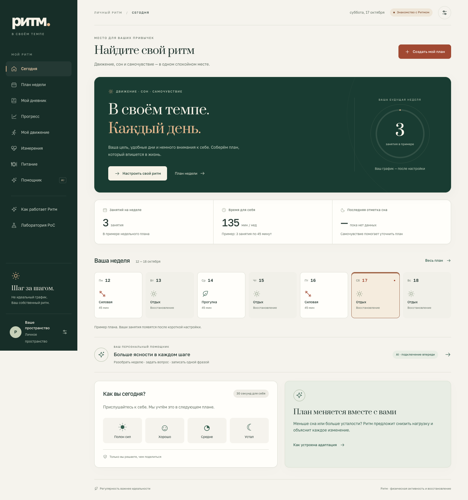

# Ритм: обновлённый визуальный стиль

17.10.2026. [Открыть сайт](http://127.0.0.1:8080/#overview).

Дизайн строится вокруг ежедневного действия: понять сегодняшний план, отметить самочувствие, посмотреть историю. Направление — спокойный wellness-продукт с редакционной типографикой: тёплая бумага, глубокий зелёный, медный акцент, ясная сетка и сдержанные поверхности. Референсы для фокуса на дне и показателях — [Oura](https://ouraring.com/how-it-works), для спокойной подачи движения и восстановления — [Gentler Streak](https://gentlerstories.com/gentlerstreak). Это самостоятельная композиция Ритма; изображения, интерфейсы и показатели этих продуктов не копировались.

## До / после

| Элемент | До | После |
|---|---|---|
| Типографика | Один внешний sans-serif для всех задач | Локальный Golos Text для действий/данных и Prata для крупных заголовков |
| Навигация | Светлая панель с однотипными пунктами | Глубокий зелёный, тонкий активный маркер, отдельный визуальный акцент AI |
| Главный экран | Повторяющиеся заголовки и плотные элементы | Более короткая главная фраза, выделенный следующий шаг, отдельная зона ритма недели |
| Показатели | Маленькие подписи и одинаковая плотность | Ясная иерархия чисел, единые интервалы, табличные цифры, улучшенный контраст |
| Календарь | Набор одинаковых карточек | Различимые дни отдыха, занятий и сегодня; горизонтальная прокрутка на телефоне |
| Помощник | Вход в основном через навигацию | Дополнительный переход с главного экрана и обновлённое оформление трёх AI-сценариев |
| Формы и детали | Разные размеры кнопок и полей | Согласованные поля, состояния, поверхности, скругления и лёгкие тени |
| Мобильный экран | Кнопка могла сжиматься около длинного заголовка | Фиксированная область 44×44 px, перенос длинных имён, спокойная нижняя навигация |
| Доступность | Вторичный цвет с недостаточным запасом контраста на фоне | Более тёмный вторичный текст, видимый клавиатурный фокус и поддержка reduced-motion |

[До — широкий экран](evidence/premium-design/before-desktop.png) · [После — широкий экран](evidence/premium-design/after-desktop.png)

[До — телефон](evidence/premium-design/before-mobile.png) · [После — телефон](evidence/premium-design/after-mobile.png) · [320 px](evidence/premium-design/after-320.png)

## Реализация и риски

Визуальный слой находится в [premium.css](../web/static/premium.css), подключён после существующих правил. Разметка изменена точечно в [views.js](../web/static/views.js): заголовок, подпись кольца, метка навигации и ссылка на помощника. Привязки действий, идентификаторы форм, данные и правила расчёта сохранены. Старое внешнее подключение Google Fonts заменено встроенными оригинальными TTF с полными SIL OFL 1.1; суммарный размер файлов шрифтов — 285 576 байт. Браузер загружает их с того же сервера.

Основные риски визуального изменения — перенос длинного русского текста, размеры элементов на 320 px, читаемость в тёмной теме, клавиатурная навигация и незаметное перекрытие кнопок. Они проверены в браузере. Найденный выход длинного имени за край исправлен до итогового прогона. Контекстный AI по-прежнему требует серверную конфигурацию, а статус её отсутствия остаётся видимым.

Изменения домена Go, публичного API, транзакций, lifecycle и конкурентности: N/A — обновление касается оформления и разметки. Go-проверки выполнены для совместимости встраиваемых статических файлов. Новых библиотек и Git-коммитов нет. Два существующих browser harness теперь принимают `RHYTHM_EVIDENCE_DIR`, чтобы новый прогон сохранялся отдельно от прошлых доказательств.

## Верификация

- `npm run check` и `npm test`: 51/51 JavaScript-тестов.
- `GOCACHE=/tmp/rhythm-go-cache go test ./...`, `go vet ./...`, `staticcheck ./...`, `gofmt -l cmd internal web`, `go build`: PASS. Go-код не менялся; новый race/load/RAT-прогон для оформления не требовался.
- 53 браузерные проверки: [основной цикл — 20](evidence/premium-design/regression/browser.json), [полный цикл — 13](evidence/premium-design/regression/full-product-browser.json), [AI/варианты — 10](evidence/premium-design/ai/browser.json), [измерения/питание — 10](evidence/premium-design/wellness/browser.json). Все используют изолированные искусственные данные. Нет необработанных JavaScript-ошибок.
- Проверены размеры 320/390/768/1024/1440 px в соответствующих сценариях, длинное имя, формы, ошибки, история и [тёмная Telegram-тема](evidence/premium-design/regression/telegram-dark-fixture.png). Это SDK fixture, не живой запуск бота.
- [Визуальная проверка](evidence/premium-design/visual-audit.json): локальная загрузка обоих шрифтов, клавиатурный фокус, reduced-motion и контраст основных текстовых цветов. Это ограниченная проверка, не полный аудит WCAG.

Точные команды, границы проверки и SHA-256: [checks.json](evidence/premium-design/checks.json), [source-manifest.json](evidence/premium-design/source-manifest.json). Последнее изменение после сценарных проверок — только повышение контраста `--muted`; после него повторно проверены цвета, шрифты, снимки и сборка.
