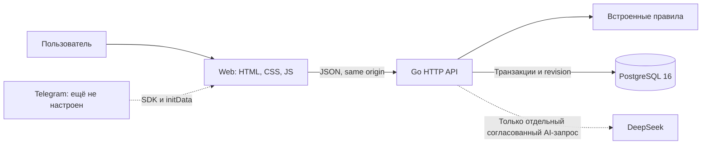

# Подробный аудит «Ритм»: код, презентация и критерии RAT-PoC

Проверено 17 октября 2026 года. Основание — предоставленные критерии «БОСС 2 · RAT-PoC», PDF из Downloads (32 слайда) и текущая реализация в `/Users/alexlepekhov/GolandProjects/pet`.

> Дополнение после аудита: приложение развёрнуто на [публичном HTTPS-адресе](https://176.119.147.97/). В этой конфигурации Nginx исправлено F3 (проверяемый адрес клиента для квот), а для F4 устранено создание пустых строк при `GET /api/state`; добавлены регрессионные тесты. Подробности и новые доказательства — в [отчёте о деплое](vps-deployment.md). Исходные наблюдения ниже относятся к сборке до деплоя. F1 и несоответствия PDF этим развёртыванием не исправлены.

**Вывод: это работающий PoC с настоящими аккаунтами, PostgreSQL и подключённым AI, но утверждать «всё готово на 9–10» сейчас нельзя.** Презентация существенно отстала от реализации. Найден воспроизводимый дефект в основном механизме восстановления, который не обнаруживается нынешним набором из 16 RAT-сценариев. Бизнес-гипотезы и работа публичного Telegram-приложения остаются непроверенными.

Это аудит, а не исправление продукта: исходный код приложения и PDF не менялись. Добавлены отчёт, результаты свежих проверок и отдельные воспроизведения найденных проблем. Пользовательский демопрофиль сохранён; браузерные проверки выполнялись в отдельном QA-окружении, его временная схема удалена. Коммиты не создавались; в рабочем каталоге вообще нет Git-репозитория, поэтому история изменений недоступна для проверки.

## 1. Самые существенные замечания

### F1 · P1 · Восстановление может увеличить предложенный недельный объём

**Это главное исправление перед заявлением, что риск T1 закрыт.** На слайде 9 обещано, что при конфликте сигналов система не повышает нагрузку. В текущем коде расчёт восстановления берёт дни и минуты из актуального профиля, а `BeforeMinutes` — из сохранённой текущей недели с учётом замен занятий. Эти две базы могут различаться.

Воспроизведены два случая через настоящие публичные функции домена, без ручной подделки сохранённого состояния:

| Действия | Текущая неделя | Предложение при усталости 9/10 | Режим |
|---|---:|---:|---|
| Создать план 3×45; заменить все занятия на 15 минут; внести усталость | 45 минут | **72 минуты** | `recover` |
| Создать план 1×15; изменить будущие настройки профиля на 5×90; внести усталость | 15 минут | **288 минут** | `recover` |

Причина: [rhythm.go:380](/Users/alexlepekhov/GolandProjects/pet/internal/rhythm/rhythm.go:380), далее `count, minutes` вычисляются из `p.Minutes`/`p.Days`, уменьшаются относительно профиля и превращаются в `nextPlan`. Сохранённое расписание правильно остаётся неизменным при редактировании профиля — [lifecycle.go:205](/Users/alexlepekhov/GolandProjects/pet/internal/rhythm/lifecycle.go:205). Ошибка возникает при сочетании этих корректных по отдельности механизмов.

Это не утверждение о физиологической эквивалентности разных занятий: найдено противоречие именно в той метрике минут, которой продукт и презентация объясняют уменьшение объёма. Предложение требует явного принятия, поэтому самопроизвольной записи увеличенного плана нет. Однако пользователь видит «восстановление» рядом с увеличением минут и может принять такой план.

Текущий RAT использует один базовый профиль 3×45 и набор отметок, не проходя историю изменения профиля/снимков/вариантов: [cases.go:25](/Users/alexlepekhov/GolandProjects/pet/internal/rat/cases.go:25). Поэтому **16/16 PASS остаётся правдивым результатом узкого теста, но не подтверждает общий инвариант для всех разрешённых сценариев**.

Минимальное направление исправления: определить явную базу восстановления и числовой инвариант для сохранённой недели, новых настроек и принятых/изменённых занятий; ограничивать предложение согласованно с этим контрактом и объяснять базу сравнения в UI. Не переписывать историю и не маскировать проблему только сменой текста. Добавить два регрессионных сценария выше, границы 1×15 и неизвестных исторических минут; проверить через HTTP запись → предложение → принятие → переход недели.

Доказательства: [входы и наблюдаемый результат](/Users/alexlepekhov/GolandProjects/pet/docs/evidence/rat-poc-audit-2026-10-17/domain-repro.json), [воспроизводимый Go-код](/Users/alexlepekhov/GolandProjects/pet/docs/evidence/rat-poc-audit-2026-10-17/domain-repro.go.txt). Это приоритет P1 для обещания продукта и защиты RAT.

### F2 · Высокий приоритет для защиты · PDF описывает другую сборку и другой эксперимент

Слайды 10/24/25 называют Node.js 22 и `node test.js`. Слайды 13/15/26/29/32 называют FastAPI будущим backend. На слайде 18 сервер и БД ещё не проверены. В текущем проекте нет корневого `test.js`; рабочий сервер — Go, БД — PostgreSQL, текущий RAT — `go run ./cmd/rat`.

Совпадение чисел «16/16» и «5/5» не делает два набора тестов одинаковыми. Например, PDF обещает нормализацию неизвестной цели и игнорирование ошибочного сна; сервер теперь отклоняет некорректный ввод. Актуальный контракт находится в [rhythm.go:134](/Users/alexlepekhov/GolandProjects/pet/internal/rhythm/rhythm.go:134) и [rhythm.go:183](/Users/alexlepekhov/GolandProjects/pet/internal/rhythm/rhythm.go:183).

**Риск на защите:** проверяющий запускает указанную команду или сопоставляет схему с кодом и не получает заявленное доказательство. Наличие более сильного приложения не исправляет неверные подписи на слайдах. Нужно явно отделить исторический Node-прототип от текущей Go-сборки либо целиком заменить сведения текущими.

Устарел и ряд внутренних документов: [architecture.md:21](/Users/alexlepekhov/GolandProjects/pet/docs/architecture.md:21) показывает OpenAI и deadline 3 секунды; реально выбран DeepSeek с default timeout 20 секунд. В [implementation-plan.md:70](/Users/alexlepekhov/GolandProjects/pet/docs/implementation-plan.md:70) PostgreSQL ещё после пилота; в старой таблице правок `defense.md` PostgreSQL предлагается оставить будущим решением. Такие фрагменты нельзя переносить в новую презентацию без сверки.

### F3 · P2 · За reverse proxy все посетители делят лимит входа

[Caddyfile:3](/Users/alexlepekhov/GolandProjects/pet/Caddyfile:3) отправляет запросы в приложение через один proxy. [accounts.go:81](/Users/alexlepekhov/GolandProjects/pet/internal/httpapi/accounts.go:81) использует `RemoteAddr` как адрес клиента и намеренно игнорирует `X-Forwarded-For`. Это защищает от подделки заголовка при прямом доступе, но при таком размещении адрес принадлежит Caddy.

Лимит peer — 50 auth-операций за 10 минут, включая успешные/неуспешные попытки: [accounts.go:218](/Users/alexlepekhov/GolandProjects/pet/internal/httpapi/accounts.go:218). После его исчерпания следующий посетитель получает 429 даже с другим логином. Ограничение действует на вход/регистрацию/восстановление/часть изменений credentials; не означает блокировку всех запросов уже вошедших пользователей.

Изолированный HTTP-тест показал: 50 запросов от разных forwarded IP дошли до проверки credentials, 51-й получил 429. [Результат](/Users/alexlepekhov/GolandProjects/pet/docs/evidence/rat-poc-audit-2026-10-17/proxy-repro.txt), [код воспроизведения](/Users/alexlepekhov/GolandProjects/pet/docs/evidence/rat-poc-audit-2026-10-17/proxy-repro_test.go.txt).

Исправление перед публичным пилотом: согласовать trusted-proxy policy с ingress; доверять forwarded адресу только от явно разрешённого proxy, сохранить отдельные лимиты по логину/глобальной нагрузке/KDF. Просто начать доверять любому `X-Forwarded-For` нельзя. Добавление лимита на Caddy само по себе не убирает нынешнюю общую корзину backend.

### F4 · P2 для публичного размещения · Анонимный bootstrap постоянно создаёт записи в БД

`GET /api/state` без cookie создаёт новый guest principal и вызывает `repo.Update`: [server.go:313](/Users/alexlepekhov/GolandProjects/pet/internal/httpapi/server.go:313). PostgreSQL adapter вставляет identity и пустой diary ещё до заполнения профиля: [store.go:160](/Users/alexlepekhov/GolandProjects/pet/internal/postgresstore/store.go:160).

В временной тестовой схеме три отдельных запроса без cookie оставили три diary и три identity. Автоматической очистки таких пустых гостей и общего лимита создания гостей в проверенном контуре нет. Ограничение размера одного дневника не ограничивает число дневников. Для localhost это небольшой эксплуатационный вопрос; после открытия в интернет боты/повторные посещения без cookie могут увеличивать БД без полезных пользовательских данных.

Минимальное направление: ленивое сохранение гостя при первой содержательной записи, либо явная политика TTL пустых гостей и лимит их создания; привязать очистку к ownership, чтобы не удалить присоединённый аккаунт. [Воспроизведение](/Users/alexlepekhov/GolandProjects/pet/docs/evidence/rat-poc-audit-2026-10-17/guest-repro_test.go.txt), [вывод SQL-проверки](/Users/alexlepekhov/GolandProjects/pet/docs/evidence/rat-poc-audit-2026-10-17/targeted-repros-initial.txt).

### F5 · Ограничение доказательств · Деградация API описана, но не автоматизирована

В PDF есть триггер `p95 >450 мс / 5 мин`, отключение графиков и возврат к нормальному режиму. В коде есть таймауты, обработка отказов, конфликтов и AI circuit breaker. Но общего измерения HTTP p95 по окну, соответствующего переключателя UI/аналитики и настроенного alerting в проверенном проекте нет. Владелец реакции отсутствует на слайдах 17/30; в документах указан ролью, конкретный дежурный не назначен.

Это допустимо обозначить как **план эксплуатации**, а не выполненную автоматическую защиту. Для уровня 8 нужен конкретный план с триггером, действием, ответственным и возвратом; критерий не требует непременно полного production-monitoring уже в PoC. Но утверждение, что данный механизм фактически испытан, было бы неверным. 30-секундный smoke не проверяет пятиминутный триггер и не является chaos-тестом отключения БД.

## 2. Что подтвердилось свежими проверками

В этом аудите использован отдельный процесс на `127.0.0.1:18081` и временная схема в `rhythm_test`. Для него AI-ключи и Telegram token не передавались. Браузерные AI/Telegram сценарии используют явно обозначенные fixtures. Основной сайт на 8080 и пользовательский дневник не участвовали в тестовых изменениях.

| Проверка | Результат | Что именно подтверждено |
|---|---|---|
| `go test -race -count=1 ./...` с test DSN | PASS | Unit/HTTP/adapter тесты, включая реальные PostgreSQL integration tests; race detector не обнаружил гонок в выполненных путях |
| `go vet ./...` | PASS | Проверки анализатора Go |
| `staticcheck ./...` | PASS | Статический анализ доступным установленным инструментом |
| `gofmt -l cmd internal web` | Пустой вывод | Проверенные Go-файлы отформатированы |
| `npm test` | **60/60** | Frontend unit-тесты |
| `npm run check` | PASS | Синтаксические проверки JS из package.json |
| `python3 scripts/test_dev.py` | **3/3** | Загрузка приватной конфигурации native launcher |
| Новый запуск `go run ./cmd/rat -json` | **16/16**, критические **5/5** | Фиксированный набор на одном базовом профиле, без проверки F1 |
| 5 000 вызовов RAT | p95 **0,007834 мс**, ошибок 0 | Локальные вычисления/валидация, не сеть, не UI, не БД |
| Браузерные сценарии | **73/73**, runtime errors 0 | 20 базовых +13 жизненный цикл +10 питание/измерения +10 AI fixtures +12 аккаунты +8 первый запуск |
| HTTP + PostgreSQL, 30 секунд, 4 workers | **300/300**, ошибок 0, около **9,9993 RPS** | Реальные синтетические записи и проверка ответа, не только HTTP 200 |
| HTTP latency | p95 **4,8705 мс**, max **9,1005 мс** | Loopback, текущая машина, небольшой объём данных; не публичный end-to-end SLO |
| Основной сервер после аудита | HTTP 200, `storage: postgresql`, `telegramConfigured: false` | Сайт и PostgreSQL работают; Telegram не настроен |

Полные результаты: [checks.json](/Users/alexlepekhov/GolandProjects/pet/docs/evidence/rat-poc-audit-2026-10-17/checks.json), [browser-checks.json](/Users/alexlepekhov/GolandProjects/pet/docs/evidence/rat-poc-audit-2026-10-17/browser-checks.json), [RAT](/Users/alexlepekhov/GolandProjects/pet/docs/evidence/rat-poc-audit-2026-10-17/rat.json), [HTTP load](/Users/alexlepekhov/GolandProjects/pet/docs/evidence/rat-poc-audit-2026-10-17/http-load.json), [основной health](/Users/alexlepekhov/GolandProjects/pet/docs/evidence/rat-poc-audit-2026-10-17/main-health.json).

Оба новых диагностических воспроизведения F3/F4 подтверждают текущее поведение, а не качество защиты. В первой версии вспомогательного F3-теста ожидался HTTP 400 для некорректного логина; сервер корректно возвращает общий 401. Эта ошибка ожидания исправлена только в audit-файле, исходный вывод сохранён. После исправления проверено ограничение на 51-м запросе. F1 воспроизведён отдельной программой и не добавлялся в основной suite: существующий PASS нельзя трактовать как отсутствие найденного дефекта.

### Настоящий AI: что уже доказано

Есть серверный DeepSeek adapter и ранее в тот же день выполнен настоящий browser → Go → DeepSeek → Go → PostgreSQL smoke на синтетическом профиле. В [финальном live-отчёте](/Users/alexlepekhov/GolandProjects/pet/docs/evidence/deepseek/live-verified/results.json) успешны все три задачи:

| Задача | Наблюдаемое время одного запроса | Проверенное поведение |
|---|---:|---|
| Запись дневника фразой | 10,122 с | Получен черновик, автоматической записи нет |
| Разбор истории | 2,584 с | Получен структурированный ответ с фактами |
| Вопрос по плану | 2,139 с | Ответ получен через настоящий provider |

Отдельно подтверждены исправление пользователем распознанного значения и сохранение после явного подтверждения. Эти три измерения — не p95 и не оценка надёжности. В более ранней попытке был HTTP 503, причина не установлена по имеющемуся evidence: [сохранённый неуспешный запуск](/Users/alexlepekhov/GolandProjects/pet/docs/evidence/deepseek/live/failure.json). Его нельзя скрывать за «3/3». В текущем аудите новые платные запросы не выполнялись. Все 20 файлов из сохранённого manifest этапа DeepSeek совпадают по хешу с текущими; полный текущий manifest содержит 133 source/config-файла.

## 3. Соответствие каждому требованию минимального уровня 5

Обозначения: **да** — есть соответствующий артефакт и подтверждение; **частично** — есть основа, но есть конкретный пробел; **не подтверждено** — отсутствует проверяемое доказательство, а не обязательно сама работа.

| Требование | Статус | Объяснение и нужное действие |
|---|---|---|
| Чёткие vision и mission | Да | Слайд 3 хорошо задаёт пользовательскую ценность и цикл. Сохранить фокус; обновить подпись о границах расширенной версии |
| User stories по шаблону | Да, с несогласованностью | Слайды 5/20/21 содержат роли, функцию и пользу. US05 на слайде 4 означает итоги, на 20 — сон/усталость. Нужен один смысл ID |
| User Story Map | Частично | На 4/22 есть backbone и релизы. Нет полной связки story ID → персона → окно → зависимости для расширенного продукта; новые аккаунты/AI/меню почти не отражены |
| 3–5 главных рисков «если — то» | Да | T1/T2 технические, A1 архитектурный, B1/B2 бизнес. Следует дополнить технические меры рисками доступа, данных и внешнего AI, не заменяя ими бизнес-риски |
| Матрица вероятность × ущерб | Да, требуется синхронизация | Слайд 8 честно называет оценки экспертными. B2 находится в V=4/U=3, тогда как текущий план задаёт V=3/U=4; произведение 12 одинаковое, смысл отличается |
| Стратегия и конкретный метод по каждому риску | В основном да | Есть правила/тесты, load test, независимость от LLM, UX comparison, пилот. Для B1/B2 решения пока являются методами будущей проверки, не результатами |
| Прикидка пиковой нагрузки с происхождением чисел | Да как модель | 10 000×0,30×4×0,25/3600×10 = 8,33 RPS. Все числа обозначены гипотезами/допущениями; внешняя статистика не заявлена. Нужно точно назвать четыре операции и учесть чтения/авторизацию отдельно |
| Первый ресурсный предел | Частично | Слайды 14/28 обсуждают LLM в отвергнутом варианте. В текущем обязательном пути её нет. Кандидаты теперь SQL pool/locks/размер агрегата; в auth уже есть общий proxy limit. Реальный первый предел не измерен |
| Критический путь с ресурсом и бюджетом | Частично | Таблица 15/28 существует, сумма 450 мс верна. Указан FastAPI и прежняя последовательность write → rules → read. Нет фактического auth SQL и текущего порядка транзакции |
| Архитектурный стиль оправдан требованием | Да в коде/ADR, PDF устарел | Монолит оправдан одной командой, транзакционным циклом и отсутствием требований к отдельному масштабированию сервисов |
| ADR на 2–3 решения | Да | В проекте 8 ADR; количества достаточно. Сверить актуальность, показать Go, rule engine, PostgreSQL и отвергнутые альтернативы |
| Названо самое рискованное допущение | Да, формулировку уточнить | T1 указан явно; B1 имеет такой же приоритет 20. Объяснить выбор T1 первым техническим RAT, не объявляя B1 менее важным |
| Критерий успеха до теста | Частично по доказательности | Пороги есть в PDF/плане/runner и не менялись для нынешнего аудита. Независимого подтверждения времени их фиксации перед первоначальным Node-прогоном нет; нет доступной Git-истории/протокола КТ |
| «Считали → проверили → получили» | Частично | Прогон Go воспроизводим. Однако общий тезис «восстановление не увеличивает объём» имеет контрпример F1. Указать границы теста и исправить обнаруженный путь |
| Метод/технология для рискованных элементов и обоснование | Да с открытыми проверками | ADR и тесты дают инженерные основания. Пороги правил демонстрационные, UX-польза не доказана; это должно оставаться явным |
| Макеты показывают основной сценарий | Да | Слайд 6 понятен; реальное приложение намного функциональнее. Лучше заменить макеты скриншотами текущей сборки с пометкой синтетических данных |
| Полные C4 L1/L2 по нотации | Частично | Иерархия уровней в целом правильна; проблемы в актуальности, подписях связей и обозначении optional/future, см. раздел 6 |
| Рабочая проверка, а не только красивый UI | Да для ограниченного набора | Есть реальный backend, БД, повторяемый RAT и HTTP/browser evidence. Но универсальное обещание T1 текущим RAT не покрывается |

Минимальный набор материалов присутствует. Тем не менее нельзя честно поставить всем строкам безусловное «выполнено»: несогласованность артефактов и F1 затрагивают именно основной смысл этапа.

## 4. Что добавляют уровни 6–10

| Уровень | Что уже есть | Что мешает считать уровень полностью закрытым |
|---|---|---|
| **6** | План деградации; бизнес-риски выделены; ADR с альтернативами; три пользовательских типа | Актуализировать базовый уровень 5; исправить F1; подписать текущий/проектный контур; уточнить бизнес-проверки и действительные механизмы отказа |
| **7** | Must/Should/Could, роли, приоритеты рисков, план работ в Markdown | PDF даёт относительные «следующая неделя», «после FastAPI» вместо согласованных окон и зависимостей; нет единой актуальной карты новых функций |
| **8** | Работающие механизмы явно превосходят первые фрагменты; есть числовые NFR, черновики, SQL transactions и AI breaker | INVEST в PDF скорее декларация; сроки/персоны/зависимости разбросаны. Нужны owner и recovery condition в деградации, числовой A1, актуальная architecture roadmap. Каждый риск должен быть связан с конкретной проверкой и её статусом |
| **9** | Рабочий образец выполняет основной цикл; RAT использует тот же Go domain; база и браузер протестированы | Уровень включает всё от 8. Не хватает согласованных материалов и устранения контрпримера T1. Demo в PDF ведёт к отсутствующему `node test.js`. Локальный запуск с разработчиком сам по себе допустим по критериям |
| **10** | Аккаунты, SQL, история, импорт, питание, измерения, три AI-сценария действительно превышают исходный PoC-план. В ADR-02 есть сравнение rule engine с LLM-only | Матрица слайда 31 связывает риск/метрику/метод, но не stories, ADR и C4-контейнеры. Нужна полная цепочка и наглядное сравнение альтернатив. Право считать обход достаточно оригинальным остаётся у комиссии; число функций этого не гарантирует |

**Оценка холистическая: точный балл из репозитория вычислить нельзя.** По объёму реализации есть материал для сильной защиты рабочего образца. По нынешнему согласованию кода/PDF и обнаруженному дефекту обещать 9–10 необоснованно. После исправления F1 и подготовки единого пакета можно обоснованно защищать требования 8–9 и отдельно предъявлять аргументы на 10.

Публичный HTTPS и настоящий Telegram полезны для завершения продукта, но сами критерии уровня 9 допускают локальный образец, который запускают разработчики. Их отсутствие не следует автоматически превращать в запрет высокой оценки PoC. Аналогично критерии не требуют завершить все бизнес-исследования до защиты технического RAT: требуют правильно описать риски, решения и проверки, честно отделив план от результата.

## 5. Как именно обработаны пять рисков

| Риск | Что сделано | Что проверено | Что остаётся |
|---|---|---|---|
| **T1: чрезмерное предложение при усталости** | Приоритет recovery над progress; независимый выбор последних sleep/fatigue; строгая валидация; предложение отдельно от принятия; неизменяемые снимки | 16 базовых кейсов, 5 критических конфликтов; тесты частичных данных, повторов, истории и вариантов | **F1 воспроизводится**. Нужны сквозные комбинации профиля/снимков/вариантов. Экспертная пригодность порогов не проверена |
| **T2: медленный дневник** | LLM исключена из записи; Go; SQL pool≤10; statement timeout 5 с, lock timeout 3 с; ограничения размеров; row locks и revision | 300 записей @10 RPS за 30 с, p95 4,87 мс; конкурентные SQL-тесты и отмена транзакций | Длительная нагрузка, большая история, auth/KDF, мобильная сеть, публичный ingress, профилирование первого предела; F3/F4 |
| **A1: отказ/непредсказуемость LLM** | Модель не определяет план и не записывает дневник. Контекст после согласия, strict parsing, квоты, таймаут, circuit breaker; локальный помощник остаётся доступен | Unit/HTTP tests ошибок, timeout, лимитов, контекста и stale revision; UI fixtures; отдельный live smoke | Качество смысла AI-ответа, стоимость и надёжность на репрезентативном наборе; актуализировать 3 с → DeepSeek 20 с |
| **B1: нет преимущества перед ChatGPT + заметками** | Единый цикл, сохранённая история, объяснения, правка черновика и план принятия; задан сравнительный UX-тест | Работоспособность функций, но не пользовательское преимущество | Нет протоколов 5–8 участников. «30+ знакомых» на слайде 2 без ответов не является доказанным предпочтением/retention |
| **B2: пользователь не ведёт дневник** | Короткая форма, пустые состояния, неизвестные значения не становятся нулями, AI-ввод фразой, ICS и уведомления открытого браузера | Технический ввод/сохранение/пустая история, отсутствие выдуманных результатов | Нет двухнедельного пилота. ≥2 записи должны быть содержательными для адаптации, а не просто двумя действиями; выбывшие включаются в знаменатель |

Правильная формулировка для защиты: **«Часть технических рисков снижена проверенными механизмами; обязательная зависимость от LLM устранена архитектурно; оставшиеся риски и ограничения перечислены»**. Фраза «мы убрали все риски» не соответствует evidence.

Для B1 можно заранее задать одинаковую задачу в двух инструментах: создать неделю, внести усталость, найти причину изменения, исправить факт. Сбалансировать порядок инструментов, записать время/ошибки/необходимую помощь/предпочтение. Порог ≥60% означает минимум 3 из 5 или 5 из 8; небольшая удобная выборка даст первый UX-сигнал, а не доказательство рынка.

Для B2 план уже содержит осмысленный знаменатель: ≥70% всех вошедших в пилот делают ≥2 содержательные отметки в каждую из двух недель; выбывшие не исключаются. Добавить определение содержательной отметки, дату старта, ответственного и шаблон фиксации результата. Проведение этих исследований в ходе данного аудита не имитировалось.

## 6. Архитектура, C4, нагрузка и деградация

### Фактическая реализация



Это поясняющая схема аудита, не замена полным C4. Node используется для frontend-тестов, но не нужен как сервер сайта. SQL adapter действительно реализован; это не JSON-файл, переименованный в БД. При этом сам diary хранится одним JSONB-агрегатом, а аккаунты, сессии, identity и служебные сведения — отдельными таблицами. Для данного атомарного сценария это объяснимый компромисс, не отсутствие БД.

**По Go-архитектуре:** домен не выполняет I/O; composition root явно собирает adapters; storage и AI зависят от контрактов потребителей; длительные операции получают context; pool закрывается после остановки HTTP; есть ограниченный cleanup rollback после отмены; mutable значения копируются; ошибки доступа/конфликта/хранилища различаются. Необходимости срочно разбивать сервис на микросервисы аудит не показал.

Существенный компромисс: `UpdateAccounts` читает полный ограниченный ledger под общим advisory lock — [accounts.go:128](/Users/alexlepekhov/GolandProjects/pet/internal/postgresstore/accounts.go:128). Обычные diary updates блокируют только свой ряд. Значит масштабирование входа нельзя выводить из нагрузочного теста гостевого дневника. Защитные пределы 10 000 accounts/50 000 sessions не являются доказанной рабочей ёмкостью.

### C4: что правильно и что исправить

На слайде 12 верно показаны Person, система целиком и внешний LLM; внутренности не смешаны с L1. На 13 есть system boundary, frontend, API, DB; rule engine правильно оставлен модулем API. Прямоугольник вместо цилиндра БД сам по себе не ошибка C4: важны уровень, типы, ответственность и связи.

Но для текущей защиты нужно:

1. Заменить FastAPI на Go, React-plan на реально используемые JS modules, PostgreSQL-plan на работающий adapter.
2. Указать DeepSeek как текущего подключённого провайдера; OpenAI — поддержанная альтернативная конфигурация, не второй обязательный вызов.
3. Показать Telegram как внешнюю систему с явной пометкой, что код интеграции есть, живое размещение не настроено. Не изображать его готовым каналом общей аккаунтной истории.
4. Подписать **назначение каждой связи**. На слайде 13 Person → SPA не подписана; `REST`/`SQL` обозначают технологию, но не объясняют действие. Лучше «ведёт дневник / UI», «изменяет профиль и отметки / JSON HTTPS», «читает и атомарно сохраняет агрегат / SQL».
5. Добавить легенду текущего/необязательного/планового и обозначить область схемы. Не требуется помещать балансировщики и все детали размещения в Container diagram.

Проверка трактовки по первичным источникам: [C4 System Context](https://c4model.com/diagrams/system-context), [C4 Container](https://c4model.com/diagrams/container), [C4 review checklist](https://c4model.com/diagrams/checklist). Эти источники использованы для проверки уровня абстракции и читаемости связей, а не для навязывания конкретного цвета/рисунка.

### Нагрузка и путь ответа

Модель 8,33 RPS арифметически корректна. Её «источники» — явно подписанные продуктовые допущения; выдавать их за измеренную аудиторию нельзя. Основной load test берёт 10 RPS как округлённый запас, но использует четыре синтетических гостя и короткие дневники. Он не моделирует 10 000 зарегистрированных клиентов, пиковую регистрацию или 500 записей в каждом JSONB.

Реальная запись проходит: клиент → HTTP auth и session binding (включая SQL для managed session) → чтение агрегата с блокировкой → проверка revision и доменная операция → UPDATE/COMMIT → расчёт projection/nextPlan → JSON → UI. Поэтому на слайдах 15/28 нужно поменять порядок и ресурсы, не только название backend.

450 мс на слайдах — сумма проектных бюджетов UI/сети/server/DB/render. В load runner 450 мс — отдельный потолок HTTP round trip. Это разные границы измерения. Сумма p95 этапов не доказывает p95 всей цепочки; локальные 4,87 мс не включают реальную мобильную сеть, публичный TLS и отрисовку. Если хочется утверждать выполнение каждого бюджета, нужны измерения отдельных этапов и end-to-end, которых сейчас нет.

После удаления LLM из критического пути называть её «первым узким местом главного сценария» неверно. Можно сохранить это как сравнение отвергнутой архитектуры. Для текущей назвать **кандидатов** (pool/row locks/JSONB/auth) и честно указать, что точка насыщения пока не установлена.

### Фактические и проектные меры отказа

| Ситуация | Статус механизма | Точная оговорка |
|---|---|---|
| Некорректные данные | Реализовано | Сервер отклоняет значения; не молча нормализует неизвестную цель и не игнорирует неверный сон |
| Потерянный ответ / повтор записи | Реализовано для поддержанных операций | Entry IDs/receipts и revision; клиент перечитывает подтверждённое состояние. Это не универсальная очередь offline sync |
| Параллельное изменение | Реализовано | SQL row lock + optimistic revision, 409 вместо перезаписи |
| Изменение аккаунта в другой вкладке | Реализовано | Session binding, блокировка операции и чужого черновика |
| Ошибка БД | Ошибка видима, rollback проверен | Подтверждение сохранения не выдаётся; клиент сохраняет scoped draft для дневника. Реальная остановка публичной БД не проводилась |
| AI недоступен | Реализовано | Дневник/правила независимы; AI UI даёт ошибку и локальную альтернативу |
| AI circuit breaker | Реализовано | 3 последовательных отказа → пауза 60 с → по одному запросу → 5 успехов для закрытия. Проверки — согласованные пользовательские запросы, не фоновые платные health-check |
| AI timeout | Реализовано | DeepSeek default 20 с, OpenAI 3 с; диапазон настройки 1–30 с. PDF с общим 3 с устарел |
| HTTP p95 >450 мс за 5 мин | План | Нет автоматического измерителя/переключения; нужен ответственный и точное восстановление, например нормальные latency/errors заданное время |
| Резервное восстановление БД | Локальное evidence есть | Ранее выполнено восстановление и сравнение 8 таблиц. Автоматический внешний backup/проверенный RPO/RTO не настроены |

## 7. Полнота продукта: что есть на самом деле

| Возможность | Реализация и границы |
|---|---|
| Профиль и недельный план | Работают. Цель, опыт, дни, время; UI preview и серверная валидация |
| Дневник | Выполнение/пропуск/сон/усталость, исправление, удаление, ограничения дат и идемпотентность |
| Адаптация | Работает на базовых кейсах; **F1 требует исправления**. Правила демонстрационные |
| Следующая неделя | Отдельное предложение, явное принятие/отмена до начала, сохранённые снимки, переход календаря |
| Прогресс | Графики 7/30 дней из фактов, неизвестное не подставляется нулём |
| Варианты занятий | Выбор времени/места/без прыжков, серверное повторное вычисление допустимости, сохранение исходных данных |
| Аккаунты | **Регистрация и авторизация есть.** Login/password, присоединение гостевой истории, восстановление по резервному коду, смена пароля, отзыв остальных сессий |
| Защита credentials | PBKDF2-SHA256, 600 000 итераций, salt; session/recovery digests; cookie HttpOnly, Secure при HTTPS; ограничения попыток. Массовая авторизация не проверена |
| База данных | **PostgreSQL реализована и используется текущим сервером.** Есть migrations/checksum, transaction/rollback, ownership и revision |
| Импорт с часов | CSV/TCX и ручная загрузка с preview/дедупликацией. Автоматической синхронизации Garmin/Apple/Strava API нет |
| Напоминания | ICS с VALARM и уведомления при открытом браузере. Нет гарантированной доставки, когда браузер закрыт; нет Telegram-рассылки |
| Метрики бега | Расчёты по импортированным/сохранённым данным, не подключение датчика или автоматический анализ техники |
| HRV / состав тела | Ручная история и раздельные совместимые серии. Не автоматический импорт InBody/часов и не диагностика |
| Питание | 18 рецептов, предпочтения/исключения, меню на 7 дней, сохранение и список покупок. Это план блюд, не факт потребления и не персональный расчёт КБЖУ |
| AI | Настоящие ask/review/checkin через DeepSeek. Передача ограниченного контекста после отдельного согласия; draft требует подтверждения |
| Автономный AI-тренер | Не реализован и намеренно не является текущим контрактом: модель не изменяет нагрузку и не назначает лечение/добавки |
| Telegram Mini App | SDK/UI/auth code и fixtures есть. Настоящий бот + HTTPS + запуск в Telegram ещё не проверены |
| Единая личность сайт ↔ Telegram | Автоматического связывания нет. Website account и Telegram principal различаются; нельзя обещать бесшовное продолжение одного дневника без отдельного решения |
| HTTPS / публичный URL | Compose/Caddy подготовлены; текущий сайт localhost HTTP. Сам факт наличия конфигурации не равен выполненному deploy |
| Долгая история | Есть явные пределы: 500 записей дневника, 500 тренировок, по 500 измерений, 500 выбранных блюд, 520 недель. Нет безлимитной истории/пагинации отдельного SQL-журнала |

Предел 500 выбранных блюд означает, что при трёх новых выборах в день заполнение достигается примерно за 167 дней. Это допустимая ограниченность PoC, но её нужно учитывать в плане развития и UX архивации. Аналогично переход к PostgreSQL сам по себе не снимает ограничения агрегата.

В открытом интерфейсе на момент проверки текущая история обозначена как **«Мой ритм · демо — Гостевое пространство»**. Наличие функции регистрации не означает, что этот конкретный дневник уже принадлежит зарегистрированному аккаунту. Заполненные тестовые графики и меню нельзя предъявлять как данные реального пилота.

### AI: что защита делает и чего не доказывает

Хорошие границы: ключ только на сервере; нельзя подменить endpoint из браузера; запрет redirects; ограничены размер/схема ответа, task, допустимые даты и ссылки на факты; контекстный token связан с пользователем/revision/provider/model; дневник не меняется от генерации; при изменении данных устаревший результат отклоняется. Есть квоты: до 4 одновременных вызовов, 6 на пользователя за 10 минут, по умолчанию 60 на сервер за час.

Но [ValidateResult](/Users/alexlepekhov/GolandProjects/pet/internal/aicoach/protocol.go:132) проверяет структуру и принадлежность fact ID, а не истинность текста. Фраза может ссылаться на реальный факт и неверно его интерпретировать. Prompt restrictions не равны гарантии отсутствия ошибочного совета. Live smoke из трёх задач не заменяет набор evaluation-сценариев: отсутствие данных, противоречия, ошибочная дата, неоднозначные числа, просьба о диагнозе, prompt injection, несоответствие вывода фактам. Для них следует отдельно измерять долю корректных отказов/уточнений, точность draft и неподтверждённых утверждений.

Ключ, ранее переданный в чат, не повторяется в отчёте. В данном аудите не установлено, что он был заменён после передачи. Для публичного размещения это отдельное действие владельца ключа, а не основание считать клиентский bundle скомпрометированным.

## 8. Проверка всех 32 слайдов

| № | Что хорошо | Замечание / точная правка |
|---:|---|---|
| 1 | Ясный продукт и цель RAT | Добавить версию проверяемой сборки/ссылку на evidence. Дата на титуле сама по себе не доказывает время отправки |
| 2 | Понятная проблема разрозненного процесса | «30+» помечено как сообщение команды без протокола — это честно. Приложить обезличенную методику/ответы либо оставить как неподтверждённое наблюдение |
| 3 | Хорошие vision/mission | «Питание… позднее» отстало от кода. Разделить первоначальный scope, уже реализованное расширение и будущие интеграции |
| 4 | Есть backbone и MoSCoW | US05 конфликтует со слайдом 20. Сон/усталость во втором ряду, хотя они Must для RAT. Синхронизировать роли, ID и релизы |
| 5 | Три истории по правильному шаблону | INVEST пояснён слишком общо. Дать проверяемую приёмку/оценку размера хотя бы по ключевым историям и ссылку на полную карту |
| 6 | Основной сценарий нагляден | Сейчас это старые макеты. Поставить настоящие экраны. Указать «предложение на следующую неделю», а не уже применённый пересчёт; показать отдельное принятие |
| 7 | Пять правильно сгруппированных рисков | k6 пока только название будущего метода; реальное evidence получено собственным Go load runner. Указать фактический инструмент. Для A1 разделить обязательные причины и дополнительный AI |
| 8 | Матрица читаема; субъективность обозначена | Уточнить V/U для B2: на рисунке 4×3, в Markdown 3×4. Объяснить выбор T1 первым при равном B1=20 |
| 9 | Есть гипотеза, метод, числовой успех | Общий тезис не выдержал F1. До исправления говорить только о фиксированных входах. Добавить новые сценарии, не скрывать прежний контрпример |
| 10 | Разделены вычисления и HTTP | Заменить Node.js результатом Go или явно оставить историческую секцию. Свежие 16/16 не распространять на все новые функции |
| 11 | Прозрачные правила вместо необъяснённой генерации | Время 45→47 — округление вниз от 5%, фактически +4,44%. Назвать правилом «до 5% с округлением». Формулировка про неизменность роли LLM актуальна, но теперь она ещё делает review/draft |
| 12 | Правильный уровень Context | Добавить текущего DeepSeek и отдельно Telegram с пометкой готовности; избегать ощущения, что HTTPS уже развёрнут |
| 13 | Правильная структура Container и граница | FastAPI заменить Go; отразить текущий, а не только целевой контур. Подписать intent всех стрелок; уточнить optional/future |
| 14 | Корректная арифметика и допущения | Разделить предел LLM-only и кандидатов текущего пути; добавить реальный HTTP/SQL smoke с областью измерения |
| 15 | Бюджеты по шагам и ресурсам | FastAPI заменить Go; показать auth/SQL/read/transaction/projection в фактическом порядке; сохранить пометку, что это бюджет |
| 16 | Три решения с мотивами и альтернативами | Указать реализованные Go/PostgreSQL и ADR-08. Сравнение PostgreSQL только с векторной БД слабое: это другая задача; добавить прежний file adapter/SQLite как близкую альтернативу без выдуманного benchmark |
| 17 | Есть план сохранения основного сценария | Добавить владельца и критерий возврата. DeepSeek timeout 20 с. Не заявлять все переключения уже работающими |
| 18 | Честно разделены доказанное и открытое | Сервер/SQL уже проверены локально, AI live smoke уже есть. Польза, экспертная проверка и удержание по-прежнему открыты |
| 19 | Три понятные аудитории | Список «вне проверенного PoC» устарел. Отдельно перечислить manual HRV/body, меню, live AI и отсутствующие прямые интеграции |
| 20 | Полные US01–05 | Согласовать US05 с картой. Приёмку сделать конкретной: уникальность, валидные диапазоны, reload, отсутствие изменения при ошибке |
| 21 | Полные US06–10 | US07: ICS/open-tab, а не гарантированные push. US09: CSV/TCX, а не автоматическая синхронизация. US10: теперь реальный AI с согласованием. Объяснить термин MUP |
| 22 | Релизные горизонтальные срезы | Устарели постоянное хранение и «после FastAPI». Включить реальные даты/окна, owners, зависимости и checkpoint 03.10 либо честно отметить отсутствие его протокола |
| 23 | Хороший реестр «если — то» | Пороги B1/B2 определить полностью: кто в знаменателе, сколько недель, что считается отметкой. A1 дать число: 0 LLM-вызовов на обязательную запись, 100% заданных сценариев без provider |
| 24 | Хорошая форма отчёта эксперимента | Обновить среду/дату/набор/файл результатов. Добавить ограничения fixed-profile и открытый F1 до исправления |
| 25 | Перечень сценариев делает тест проверяемым | Список не соответствует текущему Go RAT. Удалить `node test.js`, перечислить действительные кейсы и дополнительные lifecycle-regressions отдельно |
| 26 | Полезное уточнение ролей/интерфейсов | JS modules/Go/PostgreSQL actual, DeepSeek optional, Telegram planned; таблица не заменяет корректную C4-диаграмму |
| 27 | Происхождение всех чисел видно | Сохранить как модель; уточнить четыре действия/запроса и отсутствие load на auth/reading/assets/AI |
| 28 | Различается проектный бюджет и измерение | Исправить последовательность; инструменты k6/pg_stat_statements/OTel пометить как план, не выполненные измерения |
| 29 | Есть отвергнутые альтернативы | Все решения уже не «будущие». Согласовать ADR-01/02/08, добавить таблицу выигрышей/ограничений rule engine против LLM-only |
| 30 | Триггер → действие → возврат | Добавить ответственного; вместо фоновых 5 health-check указать 5 успешных разрешённых запросов, паузу 60 с; локальный draft не равен offline queue |
| 31 | Начало трассируемости и честные статусы | Добавить requirement ID, story ID, ADR, C4-container, конкретный test/evidence. Обновить T2/A1; T1 пометить ограниченным до F1 fix |
| 32 | Следующие эксперименты перечислены | `index.html → node test.js` заменить работающим Go-запуском и переходами UI. На защите разговор по материалам, не обязательный линейный рассказ 32 слайдов |

Визуально PDF выдержан в едином стиле, ключевые схемы и таблицы различимы. Главная проблема не «дешёвый дизайн», а достоверность и согласованность содержания. Дублирование основного блока и приложения допустимо для вопросов, но полезны оглавление/навигационные ссылки и один источник актуальных чисел.

## 9. Как должна выглядеть трассируемость для уровня 10

Ниже пример актуальной связи, а не утверждение, что все строки уже закрыты. Его можно использовать при переработке слайда 31.

| Story / цель | Риск | Числовое требование | Решение | Контейнер / код | Проверка | Статус |
|---|---|---|---|---|---|---|
| US04–06: объяснимая адаптация | T1 | 5/5 критических; ≥90% набора; инвариант объёма при recovery | ADR-02, снимки и правила | Go / `internal/rhythm` | RAT + F1 lifecycle cases | Базовый набор PASS; **F1 открыт** |
| US06: быстрый расчёт | T1/T2 | local p95<50 мс, 5000 | Встроенный rule engine | Go CPU | `cmd/rat` JSON | PASS в указанной среде |
| US04: сохранить факт | T2 | HTTP p95≤450 мс @≥8,33 RPS, без неожиданных ошибок | ADR-01/08, PostgreSQL | Web → Go → PostgreSQL | `cmd/loadtest` + SQL tests | Локальный smoke PASS; публичный предел не измерен |
| US06/10: отказ AI не теряет дневник | A1 | 0 LLM-вызовов на обязательную запись; 100% заданных основных сценариев без AI | ADR-02/05, отдельная AI boundary | Go rule module; optional DeepSeek | AI failure tests + suite без ключей | Архитектурно и локально подтверждено |
| Новый пользователь: зарегистрироваться | Доступ/целостность | Чужой principal получает отказ; 1 claim, 0 потерянных фактов | ADR-07/08, atomic claim | Web / accounts / PostgreSQL | account browser+SQL concurrency | PASS; proxy limiter F3 открыт |
| US12: открыть Mini App | Доступ/интеграция | Подпись валидна, возраст≤1 ч, future≤30 с | ADR-04, HMAC initData | Telegram → Web → Go | Auth fixtures, затем live запуск | Fixtures PASS; live не выполнен |
| US01–06: ценность единого процесса | B1 | ≥60% из 5–8 после сравнения | UX comparison protocol | Весь пользовательский цикл | Результаты участников | Не выполнено |
| US04/05: достаточно наблюдений | B2 | ≥70% всех участников, ≥2 содержательные записи каждую из 2 недель | Короткий ввод, AI draft, напоминания | Web + Go + PostgreSQL | Пилот/когортный отчёт | Не выполнено |

Для альтернативы LLM-only сравнить: обязательность внешнего вызова, повторяемость решения, возможность воспроизвести тест, отказ провайдера, стоимость вызовов и поддерживаемую область. В нашем критическом пути внешних AI-вызовов ноль; это проверяемое архитектурное преимущество. Гибкость правил меньше, чем у свободного диалога, а пригодность рекомендаций человеку не доказана ни одним этим сравнением. Не нужно выдумывать количественный benchmark исходного варианта: качественное сравнение допустимо, если ясно обозначено; дополнительные измерения усиливают аргумент, но не заменяют его честность.

## 10. Порядок действий для сильной защиты

1. **Backend, до повторного заявления о закрытом T1:** исправить F1, добавить независимые регрессии со снимками/вариантами/сменой профиля и прогнать HTTP-путь. До этого не заявлять общий запрет увеличения объёма как доказанный.
2. **Владелец презентации, до демонстрации:** синхронизировать PDF и документы вокруг одной версии Go + PostgreSQL + DeepSeek; убрать команды и результаты другой сборки. Добавить ссылку на текущий evidence и версию/хеш исходников.
3. **Продукт/архитектор, до защиты:** единые US IDs, обновлённая USM с ролями/INVEST/MoSCoW/окнами/зависимостями; полная traceability; owner/action/recovery в деградации; roadmap архитектуры с текущим PostgreSQL, а не будущим.
4. **Команда, до защиты:** проверить доступность отправленной презентации без входа, подтверждение загрузки в срок и присутствие всех участников. В рамках аудита ссылка на портал/публичную презентацию не дана, эти действия не подтверждены. Дата файла и локальная успешная проверка их не заменяют.
5. **Backend/DevOps, до публичного пилота:** F3/F4, HTTPS, настоящий Telegram smoke, контролируемые секреты, backup schedule/restore drill, latency/error monitoring. Не объявлять готовые Docker-файлы завершённым размещением.
6. **Продукт/UX, следующий эксперимент:** экспертный разбор правил и B1 comparison; затем двухнедельный B2 pilot. Даты из плана 19–30.10 / 31.10–13.11 — план, не прошедшие события; их нужно принять командой и назначить людей.

Дополнительные функции сейчас дадут меньше пользы для оценки, чем устранение F1 и согласование доказательств. Сам образец уже выходит за минимальный набор; защите нужна проверяемая связь «требование → решение → код → эксперимент → ограничение».

### Ответы на ожидаемые вопросы комиссии

**«Что у вас является RAT?»** Фиксированные искусственные входы для приоритета восстановления, пороги 5/5 критических, ≥90% набора и local p95<50 мс; команда исполняет тот же домен, который использует HTTP API. В ходе расширенного аудита обнаружена непокрытая комбинация lifecycle; до исправления нельзя расширять вывод за пределы набора.

**«Почему T1, если B1 тоже 20?»** T1 проверяется исполняемым механизмом до демонстрации предлагаемой нагрузки; B1 — отдельный равноприоритетный продуктовый эксперимент, которому нужен работающий цикл и пользователи. Выбор последовательности должен быть явным, а не означать, что рынок уже подтверждён.

**«Где у вас AI?»** Вопрос по плану, обзор 14 дней, черновик отметки из фразы через DeepSeek. Само решение по минутам остаётся в правилах. Живой smoke есть, качество на широком наборе пока не доказано.

**«Что если AI упадёт?»** Сохранение дневника и расчёт плана не вызывают provider. Дополнительный ответ может не прийти; остаются причины по правилам и локальный помощник. Есть deadline/quota/circuit breaker.

**«У вас настоящая база и логин?»** Да: PostgreSQL и account/session tables, регистрация с atomic guest claim, вход, recovery code и отзыв сессий. JSONB — формат одного агрегата внутри PostgreSQL, а не имитация хранения.

**«Вы проверили 10 000 пользователей?»** Нет. 10 000 MAU — допущение модели. Проверены 300 записей за 30 секунд при 10 RPS на локальной машине; это не число пользователей и не public-capacity test.

**«Чем лучше ChatGPT?»** Инженерно объединены история, план и подтверждённое изменение; контекст не нужно пересобирать вручную, изменения воспроизводимы. Пользовательское предпочтение пока гипотеза B1; результаты исследования не выдумываются.

**«Telegram уже работает?»** Код клиента и серверной проверки готов и тестирован fixtures; бот, публичный HTTPS и реальный launch пока не проверены. Общая история website account ↔ Telegram требует отдельного связывания.

**«Пороги безопасны?»** Этот RAT проверяет поведение программы на заданных правилах. Он не доказывает пригодность порогов для людей; экспертная проверка открыта. Наличие disclaimers не закрывает ошибку F1.

## 11. Воспроизводимость и границы аудита

Проверены все 32 страницы PDF: извлечён текст и просмотрены изображения страниц, подробно проверены матрица рисков и C4. В коде изучены связанные с основным сценарием доменные функции, HTTP/auth/AI boundaries, PostgreSQL transactions/schema/migrations, account storage, конфигурация запуска и размещения; расширенные функции проверены доступными unit/browser suites. Это не формальная сертификация безопасности и не доказательство отсутствия дефектов во всех строках проекта.

Входной PDF зафиксирован в [input.json](/Users/alexlepekhov/GolandProjects/pet/docs/evidence/rat-poc-audit-2026-10-17/input.json), текст — [presentation.txt](/Users/alexlepekhov/GolandProjects/pet/docs/evidence/rat-poc-audit-2026-10-17/presentation.txt), текущие source/config hashes — [source-manifest.json](/Users/alexlepekhov/GolandProjects/pet/docs/evidence/rat-poc-audit-2026-10-17/source-manifest.json). Предыдущие отчёты рассматривались как историческое evidence с указанными границами, а не как автоматический PASS нынешнего аудита.

Для повторения базовых проверок из корня проекта:

```sh
export GOCACHE=/tmp/rhythm-go-cache
export GOMODCACHE=/tmp/rhythm-go-modcache
export STATICCHECK_CACHE=/tmp/rhythm-staticcheck-cache
# RHYTHM_TEST_DATABASE_URL задаётся приватно; только отдельная БД с суффиксом _test.
# Без неё SQL integration tests будут пропущены.
go test -race -count=1 ./...
go vet ./...
/Users/alexlepekhov/go/bin/staticcheck ./...
gofmt -l cmd internal web
npm test
npm run check
python3 scripts/test_dev.py
go run ./cmd/rat -json
```

HTTP load — только на отдельно подготовленном QA-сервере:

```sh
go run ./cmd/loadtest -url http://127.0.0.1:18081 -rps 10 -duration 30s -workers 4
```

Для F1:

```sh
cp docs/evidence/rat-poc-audit-2026-10-17/domain-repro.go.txt .local/rat-audit-repro.go
go run .local/rat-audit-repro.go
```

F3/F4 проверены через временный Go overlay: дополнительные audit-файлы не добавлялись в исходные пакеты приложения. Они не содержат секретов. В SQL проверках использовались собственные временные схемы; основной `rhythm` не очищался. QA-процесс остановлен. Основной сайт продолжает работать.

CI в репозитории не найден: `.github` отсутствует. Локальный PASS не следует представлять как зелёный удалённый pipeline. Публичная ссылка на презентацию, факт своевременной загрузки, присутствие команды, реальный Telegram, внешний HTTPS, исследования пользователей, долговременная эксплуатация и экспертный разбор правил этим аудитом не подтверждены.
